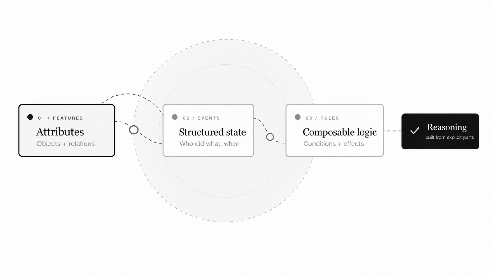

<p align="center">
  <a href="assets/reasoning-overview.png"></a>
</p>

<h1 align="center">Reasoning-AI</h1>

<p align="center">
  <strong>显式事件状态 · 可组合规则 · 可追溯推理</strong><br>
  从自然语言到 Event Graph，再由 Rule Network 组织求解。
</p>

<p align="center">
  <a href="LICENSE"></a>
  <a href="pyproject.toml"></a>
  <a href="#当前范围与限制"></a>
  <a href="#当前范围与限制"></a>
</p>

<p align="center">
  <a href="#快速开始">快速开始</a> ·
  <a href="#演示任务">演示任务</a> ·
  <a href="tech%20report/TECH_REPORT.CHINESE.md">技术报告</a> ·
  <a href="#当前范围与限制">当前边界</a> ·
  <a href="README_EN.md">English</a>
</p>

---

## 项目简介

Reasoning-AI 是 ERS 思想的可运行推理 Demo。前端 LLM 把自然语言翻译为结构化事件图；后端在当前证据上匹配、组合并执行显式规则，最后呈现经过输出门批准的结果。

核心思路是：**语义相似可以提出候选，但候选是否可执行，要由明确条件和当前证据决定。**

这是一个覆盖财务与库存／供应链的研究演示，不是通用问答产品。

## 为什么采用显式规则网络？

- **把问题状态展开。** 用 span、relation 和 Event Graph 表达事实、性质、目标和推理中间结果。
- **让规则可以组合。** Control 组织策略与后续 Rule，Executor 执行具体操作，Calculator 负责计算。
- **区分补全与猜测。** Knowledge 提供有依据的概念和性质补全，Memory 提供历史经验；它们不应替代当前缺失的事实。
- **把结论与证据关联。** 输出需要通过输出门并引用当前 Event 的有效结果，不是把所有生成内容直接当答案。

显式条件检查并不保证前端理解或知识库始终正确。能力仍取决于输入质量、知识与规则覆盖，详见[当前范围与限制](#当前范围与限制)。

## 演示任务

| 领域 | 内置任务 | 命令 |
|---|---|---|
| 财务 | 应收账款周转天数（DSO） | `python demo.py --preset dso` |
| 库存 | 库存周转变慢与资金占用 | `python demo.py --preset inventory` |
| 供应链 | 需求波动、安全库存与缺货暴露 | `python demo.py --preset stockout` |
| 跨领域 | 库存对经营现金流的影响 | `python demo.py --preset cash-flow` |
| 边界诊断 | 缺少条件时是否产生未经支持的结论 | `python demo.py --preset missing-condition` |

DSO 示例中的业务计算如下；这是结果示意，不是完整终端输出或性能基准：

```text
平均应收账款：120 百万美元
净赊销收入：  960 百万美元
期间口径：    360 天

DSO = 120 ÷ 960 × 360 = 45 天
```

> 有单位的数值结果可以由 LLM 改写表达；非数值判断保留 Decoder 的确定性草稿。缺条件任务用于诊断，不保证当前版本都能给出明确的 blocked 分类。

## 快速开始

### 1. 安装

需要 Python 3.11+、可用的 PyTorch 环境，以及可访问 SiliconFlow 的网络和 API Key。以下命令适用于 macOS／Linux shell：

```bash
git clone https://github.com/LvCheng09/Reasoning-AI-demo-v0.1.git
cd Reasoning-AI-demo-v0.1

python3 -m venv .venv
source .venv/bin/activate
python -m pip install --upgrade pip
python -m pip install -e ".[demo,dev]"
```

首次运行可能下载本地嵌入模型 `Qwen/Qwen3-Embedding-0.6B`。生成模型固定为 `Qwen/Qwen3-8B`，两者用途不同。

### 2. 配置

```bash
source .env.example
export LLM_API_KEY="你的真实密钥"
```

`.env.example` 已设置 SiliconFlow 地址和指定模型。不要把真实密钥写进 README、代码或提交记录；真实 API 调用可能产生供应商费用。

### 3. 运行

```bash
python demo.py --preset dso
```

也可以输入自己的问题，或保存运行记录：

```bash
python demo.py --question "某公司库存周转速度明显变慢。请判断是否会形成库存资金占用。" --json
python demo.py --preset dso --output demo-results/dso.json
```

自定义问题仍受当前知识和规则覆盖限制，不等于任意问题都能回答。

<details>
<summary><strong>可选配置：本地模型、超时和重试</strong></summary>

已有本地嵌入模型时，将 `MAIN_PART_EMBEDDING_MODEL` 设为快照目录，并设置 `MAIN_PART_EMBEDDING_LOCAL_FILES_ONLY=true`。

| 环境变量 | 用途 |
|---|---|
| `LLM_READ_TIMEOUT_SECONDS` | 生成请求的读取超时 |
| `LLM_MAX_OUTPUT_TOKENS` | 前端最大输出长度 |
| `LLM_MAX_RETRIES` | 前端临时请求错误的重试上限 |
| `MAIN_PART_EMBEDDING_MODEL` | 本地嵌入模型名称或目录 |
| `MAIN_PART_EMBEDDING_LOCAL_FILES_ONLY` | 是否只读取已有本地模型 |

这些配置不改变生成模型；文字入口只支持 `semantic_v1` 与 `Qwen/Qwen3-8B`。完整默认值见 [.env.example](.env.example)。

</details>

## 工作方式与技术报告

前端负责语义翻译，不在前端计算业务答案。后端通过 Python 数据接口接收事件图，使用本地向量发现候选，再依据规则条件匹配与执行；输出层只呈现已批准的结果。

| 模块 | 职责 |
|---|---|
| Semantic Frontend | 自然语言规范化、Event Graph 构建与定向补充 |
| Knowledge / Memory | 概念与性质依据／具体历史经历 |
| Control / Matcher | 组织策略、提出候选、检查当前条件与绑定 |
| Executor / Calculator | 执行 Rule、调用计算、将结果写回事件状态 |
| Output Gate / Decoder | 审查最终结果引用，解码为结构化输出与文字 |

- [中文 Tech Report](tech%20report/TECH_REPORT.CHINESE.md)：设计原因、数据结构、模块接口和代码实现。
- [English Tech Report](tech%20report/TECH_REPORT.ENGLISH.md)：对应的英文技术报告。
- [架构与运行接口](tech%20report/ARCHITECTURE.md)：模块边界与源码入口。
- [更新记录](tech%20report/RELEASE_NOTES.md)：发布版变更说明。

技术报告与 ERS 理论术语对齐，但功能以本仓库实际代码为准；不能把论文或隔离实验中的机制直接算作发布版能力。

## 验证

### 离线工程测试

不调用真实 LLM API，不下载模型：

```bash
MAIN_PART_FRONTEND_VECTORIZE=0 python -m pytest
```

[GitHub Actions](https://github.com/LvCheng09/Reasoning-AI-demo-v0.1/actions/workflows/tests.yml) 使用同一离线测试入口。工程检查数量不是实际推理题目数量。

### 真实后端回归

需要本地已有嵌入模型，使用人工构造的 Event Graph、真实向量、实际 Launcher／Scheduler、Matcher、Executor 和输出门，不调用外部 LLM，也不下载模型：

```bash
python -m tools.validate_release_runtime --output demo-results/release-check.json
```

每次使用新的输出文件名，旧记录不会覆盖。该回归不验证真实前端 LLM，也不是盲测或泛化证明。文字端到端运行还取决于前端提取、补充契约、服务可用性和网络。

<details>
<summary><strong>如何读取运行状态与输出</strong></summary>

JSON 报告包含 `execution_outcome`、`task_result`、前端和派生 spans、实际执行 Rule、答案及回退信息。状态应分别理解：

| 状态 | 含义 |
|---|---|
| `solved` | Control 明确确认求解 |
| `blocked` | Control 明确确认当前条件下受阻，不等于答对问题 |
| `incomplete` / `unresolved` | 流程未完成或结果未被确认 |
| `runtime_failed` | 发生运行失败 |

退出码：`0` 对应 solved 或 blocked，`1` 对应运行失败，`2` 对应未完成／未确认。程序结束或 Scheduler 显示 completed，不自动等于 solved。

报告分别记录初始化、前端与输入上下文、图接线、后端墙钟／进程 CPU 和输出层耗时，以及供应商返回的 token 用量。缺失用量记为未知，不按免费计算；这些记录不是 FLOPs、能耗或价格估计。

有单位的数值结果可使用同一固定模型改写表达；调用失败或改变受保护的数值／单位时回退到 Decoder 草稿，并报告回退信息。非数值、布尔和无单位判断不交给 LLM 自由改写。数值检查也不能证明所有语义始终保真。

</details>

<details>
<summary><strong>数据库隔离与运行文件</strong></summary>

`data/demo/db/knowledge.sqlite` 保存 core–relation–nature 知识网络，`data/demo/db/rule.sqlite` 保存 Rule 网络。

二者是发布种子。Demo 和默认 Python 入口先创建 `runtime/inference_*` 独立可写副本；检索计数、索引和运行 Memory 只写副本。历史 Memory 不随包发布，演示也不执行学习。

若设置 `MAIN_PART_DB_DIR`，它必须指向已有的可写运行库，不能指向发布种子。显式 `db_paths` 同样禁止指向种子库，包括符号链接和硬链接。图输入不需要 API 配置，但仍需满足图与向量契约。

最终输出需要输出门批准、明确的当前 Event 和有效结果引用；引用缺失、冲突或过期时不能任意挑选结果作答。

`runtime/`、`demo-results/`、密钥和模型权重不是发布内容，不要提交到 GitHub。

</details>

## 当前范围与限制

- **研究演示，而非生产系统。** 当前覆盖财务和库存／供应链，不承诺任意领域或任意问题都能处理。
- **前端仍可能出错。** 英文原文引用的精确对齐、属性补充的格式与极性仍需改进，不应假定英文端到端稳定。
- **缺条件不一定得到明确阻断。** 某些任务可能返回 unknown／unresolved 或达到循环上限；不能将其计为成功求解或明确 blocked。
- **非数值输出仍偏结构化。** 默认可能显示英文 Decoder 草稿，不保证自然中文解释。
- **没有发布训练部分。** Auto-Learn、训练和规则重构不在此版本中；动态中策略、完整子目标调用／返回、通用证据失效与重绑也不作为默认能力发布。
- **没有性能胜出承诺。** 不用单题耗时、规则步数或隔离实验推断普遍优于其他模型；真实效果受知识、规则、输入和运行环境影响。

## 参与贡献

欢迎通过 [Issues](https://github.com/LvCheng09/Reasoning-AI-demo-v0.1/issues) 提交可复现问题、领域案例与建议，或提交 Pull Request。

报告问题时请提供问题文本、预期行为、运行状态和已脱敏的必要日志。请勿上传 API Key、客户隐私数据、模型权重或完整私有运行库。

本项目采用 [Apache License 2.0](LICENSE)。第三方模型与服务的许可及使用条款以各自提供方为准。
