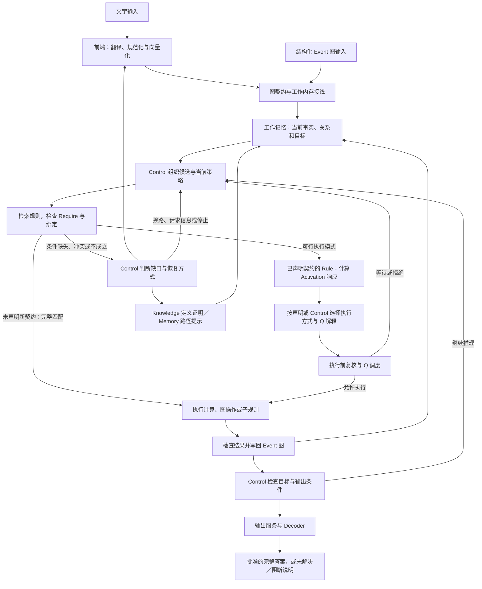

# 技术报告 显式事件状态上的规则组合推理

[English Tech Report](TECH_REPORT.ENGLISH.md) · [模块架构](ARCHITECTURE.md) · [安装与运行](../README.md)

本文说明 Reasoning-AI-demo-v0.1 的设计思想、数据结构、模块组成和实际运行过程。理论术语与 ERS v10 的第 3–4 章对齐，但实现说明以本仓库代码为准。

实现对齐日期：2026-10-21。下文区分运行时支持的机制、发布种子的实际配置，以及尚未完成的能力。

## 1 核心思想与实现范围

系统要构建的是有明确前提、可执行、可检查的推理过程，而不仅是一段看起来合理的答案。三个问题需要分开处理：

- 输入表达了哪些对象、性质和关系？
- 当前事实允许执行哪些操作？
- 在目标和预算下，应该选择哪些操作、怎样连接它们？

前端 LLM 回答第一个问题；Matcher 与执行契约检查第二个问题；Control Rule 组织第三个问题。Knowledge 提供概念定义，Memory 提供历史路径线索，Event Graph 保存本题事实和中间结果。

有限 Rule 库不等于有限数量的完整题解。相同局部操作可以重新绑定对象、数值和期间，再与其他操作连接成新路径。这个能力取决于规则覆盖、输入质量、合法连接和搜索预算，不能由“有规则组合”直接推出任意领域都能解决。

论文区分执行规则与控制规则两个功能类别。控制规则可以继续调用更具体的控制规则，因而理论上能形成任务相关的多层策略；“两个类别”不是“永远两层”。当前发布版包含有界 selector 委托、声明式顺序组合的调用／返回、Activation／Q 执行管理，以及已记录派生支持的失效复核与重绑。它不等于任意任务都能自动生成最优控制层级。

## 2 模块怎样连接

文字与结构化图共用同一个后端入口。下面按运行职责展示主线，省略底层交付记录；每轮 Control 仍可发起检索或改变继续路径。



图中的新契约路径并非所有 Rule 必经：未声明 `execution_contract_version=2` 的 Rule 仍走完整 Require 匹配后的二元执行路径；不能给旧 Rule 暗中添加 Activation 或 Q 含义。部分结果的内部计算与面向用户交付部分答案也不是一回事，见第 11 节。

实际文字调用链为 `MainPartModelLauncher.submit_input` → `SemanticFrontendAdapter.build_event_graph` → `SimpleSemanticFrontend.initial_parse` → 规范化、向量化和图契约 → `submit_frontend_state_to_working_memory` → `RuntimeLauncher.run_once` → `SchedulerNew.run`。已有图通过 `submit_event_graph` 跳过文字翻译，但不绕过图契约和运行交付。

前后端通过 Python 字典传递数据，不需要额外 HTTP 服务。HTTP 只用于模型供应商客户端。[model_launcher.py](../main_part/model_launcher.py) 组装组件，[runtime_launcher.py](../main_part/runtime_launcher.py) 交付输入，[scheduler_new.py](../main_part/scheduler_new.py) 推进阶段；它们不是领域知识库。

## 3 从语义表示到精确事实

论文的语义单元包含身份、三路语义表示、精确载荷和来源限定。代码没有照抄论文元组，而是使用 span 字典及 [SpanUnit](../main_part/data_structure.py)。

| 信息 | 当前字段 | 作用 |
| --- | --- | --- |
| 身份和类别 | `span_id`、`feature_type` | 引用、绑定和路由 |
| 语义表示 | `core_vector`、`relation_vector`、`nature_vector` | 比较概念、关系和性质 |
| 局部语义网络 | `semantic_relations` | 一个 span 内的多个 core–relation–nature 组合 |
| 精确载荷 | `value`、`unit`、实体和期间等字段 | 数值计算与声明的范围检查 |
| 来源限定 | `text`、`metadata`、来源引用、置信度 | 回查原文、保留证据 |
| 向量契约 | `embedding_model`、`vector_dimension`、`vector_version` | 防止不兼容表示混用 |

例如“期初应收账款”的概念结构可以解释为：

```text
core = accounts_receivable
relation = temporal_role
nature = beginning
```

这些标签说明三路向量的含义，不是要求靠三个字符串相等完成语义判断。同一 core 要结合 relation、nature 和邻接结构来理解；不能只凭“苹果”一个词确定公司或水果，也不能只因 sales 与 total 相邻就补出某种销售口径。

[rule_vector_encoder.py](../main_part/rule_vector_encoder.py) 编码语义字段；[vector_contracts.py](../main_part/vector_contracts.py) 检查表示兼容性；[semantic_subgraph.py](../main_part/semantic_subgraph.py) 支持局部结构检查。语义标签主要便于调试和解释，但 `feature_type`、Rule tag、ID、单位以及控制字段也参与精确判断。因此当前代码不是“所有文字都只用于 debug”。

## 4 Require、Activation 与 Q 的分工

相似度用于提出候选，不能代替执行许可。新版把“是否满足前提”“产生怎样的响应”“怎样使用响应”分开处理。

### 4.1 Require：前提、绑定和允许的执行范围

[retrieval.py](../main_part/retrieval.py)、[matcher/routing.py](../main_part/matcher/routing.py) 和 [matcher/pre_match.py](../main_part/matcher/pre_match.py) 准备候选；[matcher/matching.py](../main_part/matcher/matching.py) 检查 slot、三路向量、关系、来源和声明的数值条件。对象、单位和期间限制必须实际写进 Rule；系统不会自动知道所有领域约束。

[rule_execution_contract.py](../main_part/rule_execution_contract.py) 的 `require_evaluation` 保存完整匹配情况、绑定、缺失项和覆盖度。覆盖度不是正确概率，也不能凭分数高跳过缺失的硬前提。部分执行必须有显式 `partial_modes`，限定所需条件、输入、执行片段和输出，并由声明或 Control 授权；没有对应契约就不能部分执行。

当前 210 条发布 Rule 中，20 条声明了新版执行契约，190 条保持二元匹配；发布种子的部分执行配置全部为 `disabled`。支持部分模式的运行时代码与测试，不等于当前演示题已启用部分计算。

### 4.2 Activation：声明式响应计算

[activation_semantics.py](../main_part/activation_semantics.py) 的 `evaluate_activation` 按 `activation_spec` 计算一个或多个有类型的信号。输入可以来自当前绑定、上下文、Require 覆盖度、常数、向量运算或已注册的 Calculator 函数。信号可为布尔、实数、区间值、向量或矩阵；必须由后续解释声明其用途，不能默认视为概率或 confidence。

### 4.3 Q：响应的用途，而不是统一置信度

`resolve_q` 按 `q_semantics` 的声明或选定 profile 解释响应：

| 类别 | 支持的解释 | 消费位置 |
| --- | --- | --- |
| `dispatch` | 布尔开关、执行概率、执行频率 | `RuleExecutionRuntime.admit/start` 的调度 |
| `selection` | 可比较的选择分数 | `execution_selection.select_execution` |
| `transform` | 强度、带符号效果、权重 | 写图前的输出变换 |
| `assessment` | 显式声明的结果置信度 | 输出评价与元数据 |

这里的 Q 是解释契约，不默认等于强化学习的 Q 值。选择分数必须具有相同 `comparison_key` 才能共同比较；Control 可声明分数门槛、成本权重、预算和是否允许随机选择。概率、频率和分数是不同含义；当前种子的初始偏好也不是经过训练校准的成功率。

### 4.4 选中后仍要复核

[rule_execution_runtime.py](../main_part/rule_execution_runtime.py) 的 `inspect`、`authorize`、`admit`、`revalidate` 和 `start` 把候选快照、Control 权限、当前绑定、函数版本及执行调度串起来。新契约 Rule 执行前重新检查当前输入；绑定、Activation 或 Q 改变时必须重新选择，不能继续使用旧许可。Scheduler 通过 `_prepare_activation_candidates`、`_resolve_rule_activation` 和统一的 `_execute_rule_chain` 接入这一机制。

等待、拒绝和执行失败有不同状态。`WorkingMemoryState.rule_runtime` 保存决策、等待、函数版本和计算失败记录；可序列化不等于 Demo 已提供自动落盘和跨进程恢复的完整命令。

这里的严格检查针对已声明契约，不证明现实事实一定正确。[matcher/post_match.py](../main_part/matcher/post_match.py) 仍支持显式临时 require 修订和软条件移除；它与 Knowledge 证明后补图不同，不能用删除硬前提冒充证据成立。

## 5 Event Graph 与 Working Memory

[semantic_frontend/graph.py](../semantic_frontend/graph.py) 保存前端的小事件、主线和明示关系；[adapter.py](../semantic_frontend/adapter.py) 把它们映射成后端的 `spans`、`events`、`evidence_span_ids` 和 `relations`。

后端 [WorkingMemoryState](../main_part/data_structure.py) 按 Event 保存工作区、当前 span、关系、上下文和运行记录。主线不是一个与小事件无关的新知识体系，而是它们在当前问题下的组织方式。

[frontend_schema.py](../main_part/frontend_schema.py) 规范容器和置信度；[event_graph_contract.py](../main_part/event_graph_contract.py) 检查证据 ID、端点等结构；[frontend_working_memory_bridge.py](../main_part/frontend_working_memory_bridge.py) 将通过检查的图写入工作内存。来源引用有效不等于语义解释正确。

某个 Event 的值不能仅因语义相似就充当另一 Event 的事实。证据是否可用要检查明确关系和声明的范围；输出层还会按批准的 Event 单独投影结果，避免同名 span 串线。不同期间、不同实体的信息也必须在绑定时满足规则要求。

## 6 Rule 网络、执行契约与组合

`required` 声明条件与绑定，`produced` 声明图更新、计算、控制动作、下一条 Rule 或输出。ID、layer、tag 和优先级用于组织，不是满足前提的替代品。业务知识来自 Rule 库，Executor 不按题号查整题答案。

新版持久化在 [persistence/rule_db.py](../main_part/persistence/rule_db.py) 保留以下可选契约，由 [rule_execution_contract.py](../main_part/rule_execution_contract.py) 验证：

| 字段 | 职责 |
| --- | --- |
| `execution_contract_version` | 区分完整匹配的二元规则与显式新契约 |
| `require_policy` | 部分模式、执行方式与 Control 选择要求 |
| `activation_spec`、`q_semantics` | 响应计算与用途解释 |
| `io_contract`、`effect_contract` | 必需输入、允许输出与效果类别 |
| `composition_contract` | 子规则调用、返回绑定及深度／步骤预算 |

一条 Rule 写回的新 span 可以成为下一条的输入。`run_rule` 和 selector 支持继续检索，[rule_path_candidates.py](../main_part/rule_path_candidates.py) 组织有界兼容候选；它们不枚举所有路径，也不保证全局最优。

另外，[rule_composition.py](../main_part/rule_composition.py) 的 `RuleCompositionRuntime` 实现显式声明的顺序组合：记录父子调用帧和当前位置，逐个匹配并执行真实子规则，检查实际返回值，用 `output_bindings` 连接父输出。子规则仍通过同一 Matcher、执行许可和 Executor，不能绕过条件检查。父子调用共享有界步骤账本，并受深度限制；等待状态可通过运行状态恢复继续。

这种有界调用／返回已经有实现，但不是任意子目标自动分解、任意任务自动产生最优层数的规划器，也不是规则学习或重构。

## 7 Control 与 Scheduler 的分工

Control 是 Rule 网络中的策略层，不是另一个自由生成答案的 LLM。通用入口先观察当前目标和状态，再调用符合条件的领域策略；具体领域策略再连接可执行 Rule。

[SchedulerNew](../main_part/scheduler_new.py) 维护：

- `control_state` 和 `control_context`：当前策略、目标线索和触发原因；
- `pending_rule_selectors`、`pending_operations`：等待执行的选择或操作；
- `pending_frontend_patches`：待补充的原文信息；
- `pending_output_candidates`：尚未批准的结果；
- `controller_history`、`execution_history`：控制反馈和执行记录。

`_default_controller` 是运行宿主：按当前待处理状态启动相应阶段，冷启动请求带 `runtime_control_entry` 标签的 Control Rule。它仍有固定的阶段推进、初步 Knowledge 检索和恢复次数等工程逻辑，不能宣称 Python 里完全没有决策。固定宿主流程也不意味着每题的业务 Rule Path 固定。

失败由 `_request_control_recovery`、`_request_control_review` 等方法整理成反馈，包括未满足条件、alignment 缺口、执行错误和已尝试范围，再调用 Control Rule 选择下一步。`_synchronize_active_strategy_state` 按 Rule 声明同步当前策略并使旧策略状态不再有效，防止实际已换路而仍按旧路线放行。

[rule_selector.py](../main_part/rule_selector.py) 的 `child_rule_selectors` 传递 Control 来源、已尝试 Rule 和 hop 上限。这是搜索委托来源，不是组合调用帧；后者由 `RuleCompositionRuntime` 独立维护。控制层数、业务执行步数和搜索前瞻深度是三个不同量，不能互相替代。

声明式组合可以把若干子规则组织成有边界的调用单元；普通 Control 仍可按失败反馈选择其他 Rule 或策略。不能由调用帧的存在推断已实现任意问题的自动中策略生成，或所有失败都按最优层级局部恢复。

## 8 Knowledge 补全与 Memory 引导

二者支持推理，但职责不同。

**Knowledge 补全的是当前事实的可证明语义。** [persistence/knowledge_db.py](../main_part/persistence/knowledge_db.py) 保存向量化的概念关系；检索结果作为工作区上下文进入 [semantic_alignment.py](../main_part/semantic_alignment.py)。其中 `span_schema` 声明目标类型、三路补全向量、证据组件和激活方式：

- `explicit_components`：当前 span 的语义子图满足完整定义；
- `single_core`：定义声明一个 core 足以支持该性质；
- `all_cores`：所有指定 core 必须满足；
- `relation_context`：关系与邻接 core 一起决定含义。

`single_core`／`all_cores` 必须声明主体与支持组件；多 core 与关系语境还须通过 `binding_policy` 指定实体、期间及同 span／邻接或同 Event 的绑定范围。支持不能从另一主体或期间无条件借用，见 [knowledge_schema_contract.py](../main_part/knowledge_schema_contract.py)。这里的 Knowledge 激活模式不同于第 4 节的 Rule Activation 响应计算。

`select_span_schema_knowledge_ids` 按缺失 require 找定义；`align_event_spans` 验证前提，建立带来源与指纹的新 span，保留原值、单位、实体和期间，然后返回待重匹配的 Rule ID。原始事实不直接改写，歧义或没有证明则拒绝。必要时，后续中间结果可以暴露新的缺口，再进入下一轮补全；是否成功仍由定义和当前证据决定。

Knowledge 不能创造本题没有提供的测量值、审批或销售口径。单 core 的定义也不能把概念的一般能力当成当前已经发生的观测。

**Memory 引导搜索，不提供本题答案。** [retrieval.py](../main_part/retrieval.py)、[memory_workspace.py](../main_part/memory_workspace.py) 和 Scheduler 的 `_with_memory_path_hints` 提供历史路径线索。启用偏好后可以先尝试历史 Rule，但所有绑定仍使用当前事实；失败后可以走普通路径。旧结果不因“上次成功”自动变成当前证据。

发布包只有 Rule 与 Knowledge 种子库，没有随包发布历史 Memory。运行副本中记录上下文或检索计数不等于 post-train，也不等于修改了长期能力库。

## 9 Executor 与 Calculator

[RuleChainExecutor](../main_part/executor_new.py) 接收匹配结果和 `produced`，分派支持的操作、管理图更新和候选路径的资源占用，并记录执行结果。新契约执行通过共享的 `RuleExecutionRuntime` 复核许可，再执行 `produced`；结果受输入、输出与效果契约检查，Q 的输出变换只作用于声明目标。计算结果保留来源和派生支持；无法计算不能伪装成有效数值。

Calculator 将确定性的计算失败与当前输入／公式关联，避免在证据不变时反复执行相同失败计算；相关输入或公式变化后才重新尝试。这不是吞掉异常，Scheduler 仍收到可分类的失败反馈。

[Calculator](../main_part/calculator/service.py) 接收复制的工作区和绑定，返回计算结果，不持有可写 Working Memory。它支持结构化表达式、value policy 和函数调用；[structured_arithmetic.py](../main_part/structured_arithmetic.py) 执行表达式，[runtime_value_binding.py](../main_part/runtime_value_binding.py) 处理运行时取值。

函数调用有 function/version/parameter version 及输入输出检查，代码中也有受控小模型调用接口，但本 Demo 的正式题解依赖已导入规则和确定性计算；这不能当成非线性函数学习已完成验证。Auto-Learn 和参数训练不随发布版提供。

当前没有业务 Rule 到 Primitive Rule Set 的完整编译链。`RuleStrategyCompiler` 编译的是控制反馈中的运行程序，不是 PRS 编译器。

论文对“接受的状态变换”的定义是一项契约目标，不应扩写成所有代码操作都由通用逻辑证明器验证。执行器提供操作对应的检查、写图和错误反馈；事务范围也要区分：Runtime 的异常恢复针对内存 checkpoint，不保证持久化或工具副作用全局 exactly-once。

## 10 控制组织、调用帧与动态证据

四种结构不能混为一谈：selector 祖先链说明谁发起搜索；组合调用帧说明当前父子调用和返回位置；派生支持说明结论依赖哪些事实；执行历史说明实际尝试顺序。任何一种都不能独自代替其余结构。

[evidence_lifecycle.py](../main_part/evidence_lifecycle.py) 已进入发布推理路径，不再只是保存来源标签：

- Executor 用 `attach_derivation` 记录实际匹配前提的绑定、语义指纹、Rule 和相关关系，包括参与条件检查的前提，而不只是计算公式中的数值。
- `evidence_validity` 递归检查支持：同一支持内的前提必须全部有效；已记录的替代支持中任一条仍有效即可保留同一结论；循环自证、失效来源和过期补全不能放行。
- Control 声明 `review_event_evidence` 后，复核会将失效派生结果退役并保留原生历史；已有另一条有效支持时，可将当前来源指向该支持。
- Matcher 和输出服务检查证据有效性。修订事实后需要重新计算的结论，仍由 Control 和 Rule 再次匹配执行，不会通过“重绑”把旧数值伪装为新结果。

[alignment_contract.py](../main_part/alignment_contract.py) 继续维护语义补全的来源指纹；它与派生支持账本相互配合。以上检查针对已记录前提、关系和支持的 Event 范围，不是完整 ATMS、跨任意外部工具的依赖系统，也不是任意操作都已接入的证明。

Control 还可用 `inspect_rule_frontier` 检查有限范围内是否有可执行且能增加事实的生产规则，再决定继续或停止。未支持的操作、未检查路线或预算耗尽不能当作全局无解。没有证据、证据撤回和证据被反驳也不同；缺审批不能自动推成禁止。

## 11 输出接受与文字回答

论文的接受条件是目标、任务约束和证据同时成立。代码通过两层边界落实当前支持的检查：

1. Scheduler 的 `_append_output`、`_apply_output_gate_decision` 和 `_active_control_completion_decision` 让 Control 检查候选或当前策略的完成条件。
2. [output_service.py](../main_part/output_service.py) 仅在任务为 solved、有输出门批准、Event 范围唯一、目标 ID 有效且快照一致时，构造用户输出。显式目标必须全部可解码，来源支持失效也不能放行，不能缺一个结果就自由挑其他 span。

新契约可在内部产生带 `execution_scope=partial` 的结果，但部分结果不能被直接标为任务 solved。当前输出服务仍要求 solved 才投影正式答案；pending、blocked 和未解决状态应保留说明。因此流程图里的“部分答案”属于待完善的用户交付能力，不能仅凭部分计算已实现就宣称完成。

[output_decoder.py](../main_part/output_decoder.py) 读取结果与支持事实；不是把 embedding 数组直接翻译回文字。它使用保留的结构、语义标签和数值生成确定性草稿。

[answer_verbalizer.py](../main_part/answer_verbalizer.py) 只接收小型已批准结果，不参与 Rule 选择。非数值、布尔、无单位和未解决结果不交给 LLM 自由改写；有单位的数值可以用同一个 `Qwen/Qwen3-8B` 措辞，数值／单位守卫失败则回退并记录原因。数值守卫不保证自然语言解释的每个细节都正确。

[runtime_status.py](../main_part/runtime_status.py) 区分 solved、blocked、incomplete、unresolved 和 runtime_failed。`completed` 只表示运行生命周期完成，不能直接等同于题目解决；blocked 是有分类的阻断，不是成功得到业务答案。

## 12 一个完整的 DSO 过程

以下数值是机制说明，不是新增实验报告。已知平均应收账款 120、净赊销额 960、授权期间 360 天，三个量必须满足当前 Rule 声明的实体、期间和计量要求：

```text
前端：识别 avg_ar、net credit sales、days 与请求目标
接线：规范化 -> 三路向量 -> Contract -> Event Workspace
Control：通用入口 -> DSO 领域策略
Matcher：在本题事实中绑定所需 slot，检查声明约束
Activation / Q：对已声明的新契约计算响应、选择执行方式
执行运行时：复核当前绑定、授权和调度条件
Calculator：120 / 960 × 360 = 45
Executor：写入 dso_result = 45 days，并保留计算来源
Output Gate：检查当前策略完成条件
Output Service：只投影本 Event 的批准结果
Decoder / Verbalizer：形成数值不变的用户回答
```

若只提供期初与期末 AR，需要由支持该口径的局部 Rule 先得到平均 AR，再继续计算。若给的是普通 sales，不能仅因语义接近就当作净赊销额；Knowledge 必须证明定义前提，或选择当前事实和任务允许的其他策略。

论文附录的 revenue 示例还显式授权了该分母口径和天数约定；它不意味着当前 Demo 会默认把任意 revenue 当作净赊销。题目口径、计算值正确和推理路径成立必须一起检查。

## 13 能力扩展与成本

新路径组合是推理时的行为；新增或修改 Knowledge/Rule/Control 才是能力库的变化。运行中的图更新不等于模型已经学会新规则。Demo 不提供 post-train；扩展领域需要导入对应的定义、可执行规则和策略，并重新验证前端接线、反例和输出约束。

当前事实与规则下存在合法路径，不等于预算内一定能发现它。没有发现的原因可能是规则缺失、召回不足、绑定不成立或控制预算耗尽，不能仅凭一次失败确定原因。

层级组织的收益是减少无关搜索和重复评估，而不是“层数越多越省”。它同时增加控制和组织开销。只有节省的搜索与执行成本超过新增控制成本，整体才更省；少执行业务 Rule 也不必然意味着墙钟或 CPU 更低。

当前 [demo.py](../demo.py)、Launcher 和 LLM 客户端记录分阶段耗时、后端进程 CPU、请求次数、供应商 token 和回退。缺用量记为未知。论文中的前瞻、动态控制成本和预算对照不在这里复刻为性能承诺；这里也没有自动计算能力上限的工具。

## 14 怎样验证这些模块

离线测试检查接口与约束，不应被当成真实 LLM 的语义质量或广泛泛化证明：

- [test_semantic_frontend.py](../tests/test_semantic_frontend.py)：数据边界、补图和向量刷新。
- [test_release_safety.py](../tests/test_release_safety.py)：模型限制、输出门、Event 隔离和种子库保护。
- [test_release_runtime.py](../tests/test_release_runtime.py)：输入交付失败、API 契约、用量和回退。
- [test_output_presentation.py](../tests/test_output_presentation.py) 与 [output_decoder/](../tests/output_decoder/)：结果选择和解码。

- [test_rule_activation.py](../tests/test_rule_activation.py)：响应、Q、授权、部分执行、等待与嵌套组合。
- [test_execution_selection.py](../tests/test_execution_selection.py)：可比分数、Control 选择与执行复核。
- [test_require_gaps.py](../tests/test_require_gaps.py)：缺口分类、真实 Scheduler 恢复与补充信息后的重匹配。
- [test_evidence_lifecycle.py](../tests/test_evidence_lifecycle.py)：派生失效、替代支持、历史与祖先链。
- [test_context_contract_fixes.py](../tests/test_context_contract_fixes.py)：主体／期间绑定与补全证据变化。
- [test_deterministic_computation_recovery.py](../tests/test_deterministic_computation_recovery.py)：重复计算失败抑制与证据变化后的恢复。
- [test_portable_seed.py](../tests/test_portable_seed.py)：种子校验、恢复、隔离与学习规则排除。

[validate_release_runtime.py](../tools/validate_release_runtime.py) 从人工构造的图运行真实本地向量和完整 Scheduler；它不调用外部前端，也不是盲测。安装、命令及运行限制见 [README](../README.md)。

## 15 代码目录与发布边界

| 组成 | 代码位置 | 为什么独立 |
| --- | --- | --- |
| 语义前端 | `semantic_frontend/` | 输入翻译与领域推理解耦 |
| 组装与交付 | `model_launcher.py`、`runtime_launcher.py` | 配置、输入可靠交付与业务逻辑分开 |
| 当前状态 | `data_structure.py`、`control_state.py` | 事实、控制状态与运行记录有明确归属 |
| 契约与接线 | `frontend_schema.py`、`event_graph_contract.py`、`frontend_working_memory_bridge.py` | 不把容器错误带进匹配 |
| 检索与补全 | `retrieval.py`、`semantic_alignment.py`、`semantic_subgraph.py` | 相似候选、定义证明与写图分别处理 |
| 调度与控制 | `scheduler_new.py`、`control_voc.py` | 推进阶段、观察状态、调用策略 |
| 严格匹配 | `matcher/` | 条件成立与候选评分分开 |
| 路径组织 | `rule_selector.py`、`rule_path_candidates.py` | 支持局部委托、冲突与继续路径 |
| 响应与执行许可 | `activation_semantics.py`、`rule_execution_contract.py`、`rule_execution_runtime.py` | 前提、响应、解释与执行授权分开 |
| 执行选择与组合 | `execution_selection.py`、`rule_composition.py` | 可比候选选择与子规则调用分开 |
| 缺口与证据 | `require_gaps.py`、`evidence_lifecycle.py` | 恢复决策与来源有效性检查分开 |
| 执行和计算 | `executor_new.py`、`calculator/` | 写图与计算服务分开 |
| 持久化与隔离 | `persistence/`、`runtime_databases.py` | 公共种子与可写运行副本分开 |
| 结果展示 | `output_service.py`、`output_decoder.py`、`answer_verbalizer.py` | 展示不能重新授权推理 |

表中未写前缀的 Python 文件均位于 `main_part/`。

发布种子为 `data/demo_v2/seed.json.gz`，含 210 条推理 Rule、106 条 Knowledge；`manifest.json` 保存数量与校验和。默认入口由 [demo_seed.py](../main_part/demo_seed.py) 校验后恢复到独立的 `runtime/inference_*` SQLite 库，运行 Memory 从空库开始。原发布的 191 条 Rule 保留并更新，新增 19 条通用推理 Control；36 条学习 Rule 和 13 条新增宽泛金融业务 Rule 未纳入此发布种子。后 13 条曾干扰供应链候选选择，排除不代表干扰问题已经修复。旧 `data/demo/db/` 仅为显式回归种子，不是默认入口。检索计数和索引只写运行库，显式路径也不能用软／硬链接绕回旧种子。

本仓库提供两个相连领域的推理 Demo，不包含论文原文、实验数据、Auto-Learn、训练任务、PRS 编译器或视觉入口；有界组合与动态证据维护以第 6、10 节的实际范围为准。显式条件与规则执行借鉴生产系统、分层规划和真值维护的已有机制；本设计重点是它们与语义候选、当前 Event 状态和执行反馈的结合，而不是宣称这些单个机制从未存在。

## 16 与世界模型的对比

以下按照 ERS v10 论文附录 B 的八个方向介绍架构差异。这里的世界模型主要指通过学习环境表示和状态变化来预测未来、支持规划的系统，不代表所有世界模型都具有相同结构。这是设计层面的比较，不是实测性能、成本或能力优劣的结论；ERS 的理论机制与当前 Demo 的实现范围仍按前文区分。

### 16.1 推理机制与逻辑可靠性

世界模型学习环境及其变化规律，在潜在空间中预测动作可能产生的后续状态。预测具有统计合理性，不等于某一步已经满足明确的逻辑条件，也不等于结果的证据依赖成立。

ERS 用可执行 Rule 连接当前事实和新结果，检查前提、对象绑定、适用条件及支持来源。在代码中，这一分工对应 Matcher 的条件检查和 Executor 的操作执行。可靠性依赖输入与已声明契约，不意味着规则系统不会出错。

### 16.2 层级组织与动态问题解决

一些分层世界模型使用预设层级，或通过学习形成层级表示；仅观察潜在状态不一定能直接指出哪条前提失败、哪条规则冲突或哪项依赖变化。

ERS 的理论设计根据当前任务的依赖结构组织控制层级：缺少前提、出现新信息或执行失败时，调整相关子目标和继续路径，而不只是让原路径继续产生低质量结果。当前 Demo 已提供 selector 委托、策略同步、失败反馈，以及声明式顺序子规则调用／返回；它们不等于任意任务的自动中策略生成与最优层级选择。

### 16.3 能力扩展与长期维护

依赖参数化表示的世界模型，纳入新领域知识时可能需要继续训练或微调；参数更新也可能影响旧行为。不同实现还可以结合外部记忆、工具或模块，因此这不是所有世界模型都必须整体重训的判断。

ERS 将 Knowledge 定义、执行 Rule 和 Control 策略分开管理，可以通过添加、修改或替换对应组件扩展领域，而不必把每项业务变化都写入语义模型参数。移除不需要的组件也会改变候选范围和搜索成本。当前代码的持久化与检索模块体现了这种分工，但新组件仍需验证；本 Demo 不包含自动学习或自动卸载策略。

### 16.4 语义理解与逻辑执行的结合

神经模型擅长从多样表达中提取连续语义特征；显式执行系统则提供可检查的操作条件。两者分别在输入灵活性和条件可核验性上承担不同职责。

ERS 用统一的 Event 表示连接二者：前端识别对象、属性和关系，后端在当前状态上选择、匹配、执行并检查 Rule。相似度提出候选，绑定、适用条件和证据决定能否使用。当前实现对应 `semantic_frontend/`、图数据边界、`matcher/` 和 `executor_new.py`，语义模型与领域规则可以分别维护。

### 16.5 错误定位与修正响应

潜在状态预测失败时，内部表示本身未必直接说明是输入事实错误、缺少知识、条件不成立，还是规划没有找到可行路径。

ERS 记录实际绑定、匹配失败、执行结果和来源，使不同问题对应不同处理：补充知识、扩展 Rule、重新匹配或调整 Control 策略。当前 Scheduler 的恢复反馈提供可检查的失败位置，但位置不等于原因已经完全确定；语义编码错误可能需要回查原文，没有召回候选也不能直接证明规则库没有可行规则。

### 16.6 动态状态维护

事实与任务约束会改变。没有显式依赖记录时，仅靠状态预测难以直接确定哪些旧结论受影响、哪些结论仍有独立支持。

ERS 的理论机制保留对象身份、有效期间、来源和推导依赖：前提修改、撤回或失效后，复核相关下游支持；若其他独立依据仍有效，则保留结论。撤回不是反驳，失去一条支持也不等于全部支持消失。当前 Demo 已通过派生支持记录、递归有效性检查、Control 复核、历史保留和已记录替代支持的重绑落实其中一部分。覆盖范围是已接入的 Event 派生与关系，不是完整 ATMS 或任意外部操作的依赖维护。

### 16.7 推理评价与输出接受

答案匹配、参考路径一致或外部评分可以衡量结果，但答案正确不自动说明过程有效；一条不同于参考路径的合法解法也不应仅因不同而被否定。

ERS 分别考察目标是否满足、操作条件是否成立、证据是否支持结果。满足同一目标和约束的替代路径可以接受，缺少必要前提的结论则不能放行。当前代码由 Output Gate、`output_service.py` 和 Decoder 承担发布版的接受与展示边界；它们不是完整事实真实性证明器。

### 16.8 不确定性与信息缺口

不完整信息、证据冲突和未满足前提，不只是生成答案之后附上的置信度问题，也会改变哪些操作可以执行、接下来应查什么信息。

ERS 在理论上区分已确认事实、假设、未解决关系和有支持的结论，让证据状态直接影响 Rule 许可与 Control 选择。证据不足时可以阻断操作、尝试 Knowledge 补全、调整路径或保持未确定；获得有效新信息后可以重新考虑原先受阻的路径。当前 Demo 提供补全、定向补图和任务状态接口，但这些接口不等于所有冲突处理与动态恢复场景都已验证。

世界模型与 ERS 也可以互补：世界模型预测可能的环境变化，ERS 将这些预测作为带来源和适用条件的候选信息，检查它们能否支持当前推理。关键区别是“预测可能发生什么”与“在什么前提下允许接受这个推导”，而不是把两类系统视为相同任务上的直接替代品。
