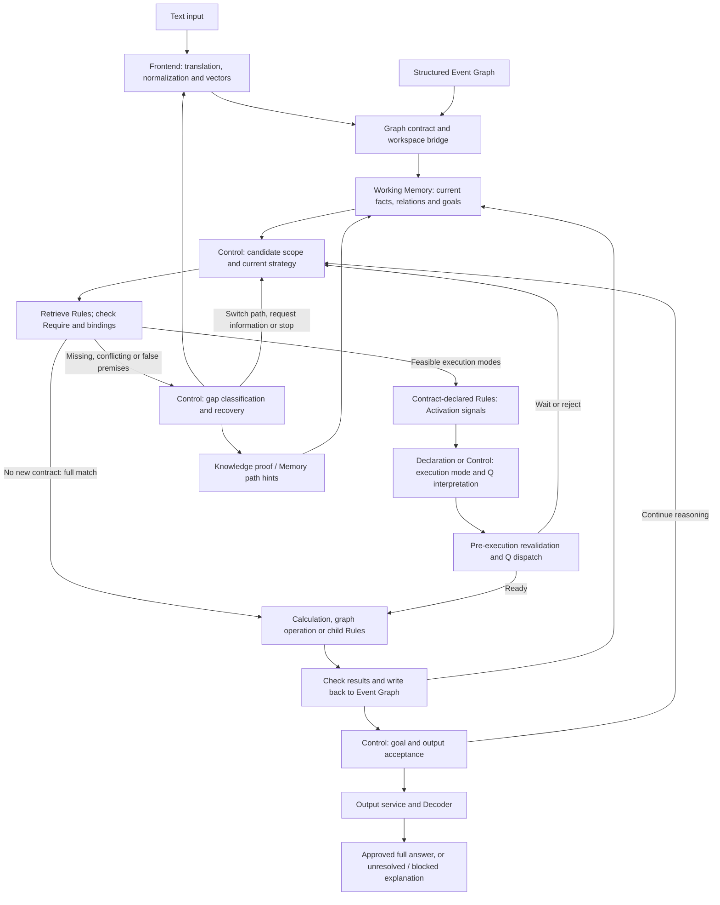

# Tech Report: Rule Composition over Explicit Event States

[中文版技术报告](TECH_REPORT.CHINESE.md) · [Architecture](ARCHITECTURE.md) · [Installation and commands](../README_EN.md)

This tech report explains the design, data structures, components, and actual execution of Reasoning-AI-demo-v0.1. Its terminology follows Chapters 3–4 of the ERS v10 theory manuscript, but implementation statements refer to this repository. Research-only mechanisms are not presented as released capabilities. This is neither the paper nor an experimental-results or performance-comparison report.

Implementation alignment: 2026-10-21. The report distinguishes runtime mechanisms, actual released seed configuration, and capabilities that remain incomplete.

## 1 Design principle and implementation scope

The system constructs an executable, inspectable reasoning process with explicit premises rather than accepting a plausible explanation alone. It separates three questions:

- Which objects, properties, and relations does the input express?
- Which operations are admissible on the current facts?
- Which operations should be selected and connected under the goal and budget?

The frontend LLM addresses the first question. Matcher and execution contracts check the second. Control Rules organize the third. Knowledge supplies definitions, Memory supplies historical path hints, and the Event Graph holds the current facts and intermediate results.

A finite Rule library need not store a complete solution for every task. A local operation can be rebound to new objects, values, and periods and connected to other operations. The resulting coverage depends on Rule coverage, input quality, admissible composition, and search budget. Rule composition does not establish arbitrary-domain competence.

The paper distinguishes execution and control rules by function; two categories do not imply exactly two levels. The release now includes bounded selector delegation, declared sequential child calls and returns, Activation/Q execution management, and validity review and rebinding of recorded derivation supports. These mechanisms do not establish optimal automatically generated control hierarchies for arbitrary tasks.

## 2 How the components connect

Text and structured graphs converge at the same backend boundary. This diagram shows runtime responsibilities rather than every delivery record; Control may request retrieval or change the continuation on each round.



Not every Rule follows the new-contract branch. Rules without `execution_contract_version=2` retain full-Require binary execution; Activation and Q meanings are not silently added to them. Internal partial results are not automatically user-facing partial answers; see Section 11.

The text call chain is `MainPartModelLauncher.submit_input` → `SemanticFrontendAdapter.build_event_graph` → `SimpleSemanticFrontend.initial_parse` → normalization, vectors and graph validation → `submit_frontend_state_to_working_memory` → `RuntimeLauncher.run_once` → `SchedulerNew.run`. `submit_event_graph` skips text translation, not graph validation or delivery.

Frontend/backend communication uses in-process Python dictionaries, not a separate HTTP server. Only provider clients require HTTP. [model_launcher.py](../main_part/model_launcher.py) assembles components, [runtime_launcher.py](../main_part/runtime_launcher.py) delivers inputs, and [scheduler_new.py](../main_part/scheduler_new.py) advances stages; none is a domain knowledge library.

## 3 Semantic representation and exact facts

The paper's semantic unit combines identity, three semantic channels, an exact payload, and source qualifiers. The code uses span dictionaries and [SpanUnit](../main_part/data_structure.py), not a literal implementation of the paper's tuple.

| Information | Current fields | Purpose |
| --- | --- | --- |
| Identity and category | `span_id`, `feature_type` | References, binding, routing |
| Semantic representation | `core_vector`, `relation_vector`, `nature_vector` | Concept, relation, and attribute comparison |
| Local semantic network | `semantic_relations` | Multiple core–relation–nature combinations within a span |
| Exact payload | `value`, `unit`, entity and period fields | Computation and declared scope checks |
| Source qualifiers | `text`, `metadata`, references, confidence | Source inspection and evidence retention |
| Vector contract | `embedding_model`, `vector_dimension`, `vector_version` | Representation compatibility |

For example, beginning accounts receivable has the conceptual structure:

```text
core = accounts_receivable
relation = temporal_role
nature = beginning
```

These labels explain the vector channels; they do not require three equal strings to establish semantic identity. A core is interpreted with its relation, nature, and neighborhood. The word “apple” alone does not establish company versus fruit, nor does adjacency between sales and total establish an authorized sales basis.

[rule_vector_encoder.py](../main_part/rule_vector_encoder.py) encodes semantic fields, [vector_contracts.py](../main_part/vector_contracts.py) checks compatibility, and [semantic_subgraph.py](../main_part/semantic_subgraph.py) checks local structure. Semantic labels mainly support debugging and explanation, but `feature_type`, Rule tags, IDs, units, and control fields also participate in exact checks. It would be inaccurate to say that every textual field in this implementation is debug-only.

## 4 Separate Require, Activation and Q

Similarity nominates candidates; it does not grant execution permission. The updated design separates premise satisfaction, computed responses, and the use of those responses.

### 4.1 Require: premises, bindings and execution scope

[retrieval.py](../main_part/retrieval.py), [matcher/routing.py](../main_part/matcher/routing.py), and [matcher/pre_match.py](../main_part/matcher/pre_match.py) prepare candidates. [matcher/matching.py](../main_part/matcher/matching.py) checks slots, semantic vectors, relations, provenance and declared numerical predicates. Entity, unit and period restrictions must be declared; the system does not implicitly know every domain constraint.

`require_evaluation` in [rule_execution_contract.py](../main_part/rule_execution_contract.py) records full matching, bindings, missing requirements and coverage. Coverage is not correctness probability and cannot override a missing hard premise. Partial execution needs explicit `partial_modes` declaring required premises, inputs, produced subsets and outputs, plus declaration- or Control-based authorization. Without that contract, partial execution is not permitted.

Of the 210 released Rules, 20 declare the new execution contract and 190 retain binary matching. Every released seed Rule has partial execution `disabled`. Runtime support and tests for partial modes do not mean the current demonstration cases enable partial computation.

### 4.2 Activation: declared response computation

`evaluate_activation` in [activation_semantics.py](../main_part/activation_semantics.py) evaluates one or more typed signals from `activation_spec`. Sources include current bindings, context, Require coverage, constants, vector operations and registered Calculator functions. Signals may be Boolean, real, unit-interval, vector or matrix values. Their uses require explicit interpretation; no signal is implicitly a probability or confidence.

### 4.3 Q: response interpretation, not a universal confidence

`resolve_q` interprets responses according to `q_semantics` or a selected profile:

| Category | Supported meanings | Consumer |
| --- | --- | --- |
| `dispatch` | Boolean gate, execution probability, frequency | `RuleExecutionRuntime.admit/start` |
| `selection` | Comparable selection score | `execution_selection.select_execution` |
| `transform` | Intensity, signed effect, weight | Output transformation before graph writeback |
| `assessment` | Explicit result confidence | Result assessment and metadata |

Q is an interpretation contract, not necessarily a reinforcement-learning Q value. Selection scores need the same `comparison_key` to be compared. Control may declare score thresholds, cost weights, budgets and whether random selection is allowed. Probability, frequency and score have different meanings; authored seed preferences are not trained, calibrated success rates.

### 4.4 Selection still requires revalidation

`inspect`, `authorize`, `admit`, `revalidate` and `start` in [rule_execution_runtime.py](../main_part/rule_execution_runtime.py) connect candidate snapshots, Control authority, current bindings, function versions and dispatch. New-contract Rules recheck current inputs before execution. Changed bindings, Activation or Q require reselection instead of reuse of an obsolete permission. Scheduler integrates this through `_prepare_activation_candidates`, `_resolve_rule_activation` and its shared `_execute_rule_chain`.

Waiting, rejection and execution failure are different outcomes. `WorkingMemoryState.rule_runtime` stores decisions, waiting states, function versions and computation failures. Serializable state is not a complete Demo CLI for automatic disk checkpoints and cross-process resume.

Strictness applies to declared contracts, not guaranteed real-world truth. [matcher/post_match.py](../main_part/matcher/post_match.py) still supports explicit temporary require revision and soft-condition removal. Those operations are distinct from Knowledge-proven completion and cannot make deletion of a hard premise count as supporting evidence.

## 5 Event Graph and Working Memory

[semantic_frontend/graph.py](../semantic_frontend/graph.py) stores frontend events, mainlines, and explicit relations. [adapter.py](../semantic_frontend/adapter.py) maps these into backend `spans`, `events`, `evidence_span_ids`, and `relations`.

Backend [WorkingMemoryState](../main_part/data_structure.py) holds per-Event workspaces, spans, relations, contexts, and runtime records. A mainline organizes smaller events for a current problem; it is not a separate knowledge system.

[frontend_schema.py](../main_part/frontend_schema.py) normalizes containers and confidence. [event_graph_contract.py](../main_part/event_graph_contract.py) validates evidence IDs and relation endpoints. [frontend_working_memory_bridge.py](../main_part/frontend_working_memory_bridge.py) stores accepted graph structure. A valid source reference does not establish a correct semantic interpretation.

One Event's value cannot become another Event's fact merely through similarity. Reuse requires explicit relations and declared scope compatibility. The presentation layer additionally projects results within the approved Event to prevent identical span IDs from mixing results. Bindings must also satisfy declared entity and period constraints.

## 6 Rule networks, execution contracts and composition

`required` declares premises and bindings; `produced` declares graph updates, calculations, control actions, subsequent Rules or outputs. IDs, layers, tags and priorities organize selection, not premise satisfaction. Business knowledge comes from the Rule registry, not a question-ID lookup in Executor.

[persistence/rule_db.py](../main_part/persistence/rule_db.py) preserves the following optional contracts, checked by [rule_execution_contract.py](../main_part/rule_execution_contract.py):

| Field | Responsibility |
| --- | --- |
| `execution_contract_version` | Distinguishes full-match binary Rules from explicit new contracts |
| `require_policy` | Partial modes, execution mode and Control selection requirements |
| `activation_spec`, `q_semantics` | Response computation and interpretation |
| `io_contract`, `effect_contract` | Required inputs, permitted outputs and effect category |
| `composition_contract` | Child calls, return bindings, depth and step budgets |

A newly written span can become another Rule's input. `run_rule` and selectors support further retrieval; [rule_path_candidates.py](../main_part/rule_path_candidates.py) organizes bounded compatible alternatives. These mechanisms do not enumerate every path or guarantee global optimality.

`RuleCompositionRuntime` in [rule_composition.py](../main_part/rule_composition.py) additionally implements explicitly declared sequential composition: parent/child frames and positions, fresh matching and execution of actual children, checked return values, and `output_bindings` for parent outputs. Children use the same Matcher, admission runtime and Executor; composition does not bypass prerequisites. Nested calls share a bounded step ledger and a depth limit, and waiting frames can continue from restored runtime state.

This bounded call/return mechanism is implemented. It is not arbitrary automatic subgoal decomposition, optimal task-dependent depth selection, Rule learning or reconstruction.

## 7 Control and Scheduler

Control is the strategy layer of the Rule network, not another unconstrained answer-generating LLM. A generic entry observes the goal and state, invokes an applicable domain strategy, and connects that strategy to executable Rules.

[SchedulerNew](../main_part/scheduler_new.py) maintains:

- `control_state` and `control_context`: active strategy, goal information, and triggers;
- `pending_rule_selectors` and `pending_operations`: pending choices and operations;
- `pending_frontend_patches`: requests for source-text clarification;
- `pending_output_candidates`: unapproved results;
- `controller_history` and `execution_history`: control feedback and execution records.

`_default_controller` is the runtime host. It advances stages from pending state and requests `runtime_control_entry` Rules at cold start. Fixed stage scheduling, coarse Knowledge retrieval, and recovery limits still exist in Python. The implementation is not entirely free of procedural decisions, but a fixed host loop does not make every business Rule Path fixed.

`_request_control_recovery` and `_request_control_review` organize unmet conditions, alignment gaps, execution errors, and attempted scope into feedback for Control. `_synchronize_active_strategy_state` applies a Rule-declared strategy update and deactivates the old strategy state so recovery does not authorize output under an obsolete route.

In [rule_selector.py](../main_part/rule_selector.py), `child_rule_selectors` propagates Control ancestry, attempted Rules, and a hop limit. This records search delegation, not composition frames; `RuleCompositionRuntime` maintains the latter separately. Control depth, executed business-step count, and search-lookahead depth are different quantities.

Declared compositions group child Rules into bounded invocation units; ordinary Control can still select another Rule or strategy after failure. Frames do not establish automatic intermediate-strategy generation for arbitrary problems or optimal local recovery for every failure.

## 8 Knowledge completion and Memory guidance

The two mechanisms support reasoning in different ways.

**Knowledge proves semantic properties of current facts.** [persistence/knowledge_db.py](../main_part/persistence/knowledge_db.py) stores vectorized concept relations. Retrieved definitions become workspace context consumed by [semantic_alignment.py](../main_part/semantic_alignment.py). A `span_schema` specifies a target type, three completion vectors, evidence components, and an activation mode:

- `explicit_components`: the span's semantic subgraph satisfies the definition;
- `single_core`: the definition declares that one core supports the property;
- `all_cores`: every specified core must hold;
- `relation_context`: relations and adjacent cores determine the interpretation.

`single_core`/`all_cores` require explicit subject/support roles. Multi-core and relation-context definitions additionally declare `binding_policy` for entity, period and same-span/linked or same-Event scope. Support cannot be borrowed unconditionally from another entity or period; see [knowledge_schema_contract.py](../main_part/knowledge_schema_contract.py). These Knowledge activation modes are distinct from Rule Activation response computation in Section 4.

`select_span_schema_knowledge_ids` locates definitions for missing requirements. `align_event_spans` verifies premises and creates a provenance- and fingerprint-bearing span while preserving the original value, unit, entity, and period. It returns Rule IDs for rematching. Originals are not rewritten; ambiguity and unsupported completion are rejected. Subsequent intermediate results may expose further gaps and trigger another completion round, subject to definitions and evidence.

Knowledge cannot create an unobserved measurement, approval, or sales basis. A single-core definition does not turn a general capability into a current observation.

**Memory guides search, not current answers.** [retrieval.py](../main_part/retrieval.py), [memory_workspace.py](../main_part/memory_workspace.py), and Scheduler's `_with_memory_path_hints` expose historical path hints. When enabled, a historical Rule path may be preferred, but every binding still uses current facts. Failure may return to ordinary candidates. A previous answer is not evidence merely because it was once successful.

The release ships Rule and Knowledge seeds, not historical Memory. Recording runtime context or retrieval statistics in a copy is not post-training or a persistent capability-library update.

## 9 Executor and Calculator

[RuleChainExecutor](../main_part/executor_new.py) receives matched Rules and `produced`, dispatches supported operations, manages graph writes and candidate-path resource claims, and records outcomes. New-contract execution uses the shared `RuleExecutionRuntime` before `produced`. Input, output and effect contracts constrain results; Q output transformations target only declared outputs. Computed results retain sources and derivation supports. A failed calculation cannot masquerade as a valid number.

Calculator associates deterministic computation failures with current inputs and expressions, preventing unchanged failures from being repeatedly recomputed. Changed relevant inputs or expressions permit another attempt. Errors remain visible and classified in Scheduler feedback.

[Calculator](../main_part/calculator/service.py) receives copied workspace data and bindings and returns results without owning writable Working Memory. It supports structured expressions, value policies, and function calls. [structured_arithmetic.py](../main_part/structured_arithmetic.py) evaluates expressions; [runtime_value_binding.py](../main_part/runtime_value_binding.py) resolves runtime values.

Function calls have function/version/parameter-version and input/output contracts. Controlled small-model interfaces exist, but formal demo solutions rely on imported Rules and deterministic calculations. Their existence does not establish learned nonlinear-function performance. Auto-Learn and parameter training are not distributed.

There is no complete business-Rule-to-Primitive-Rule-Set compilation chain. `RuleStrategyCompiler` compiles controller feedback into a runtime program; it is not a PRS compiler.

The paper's accepted-transition definition is a specification objective, not evidence of a general logical verifier over all code operations. Executor supplies operation-specific checks, graph writes, and error feedback. Transaction boundaries also matter: Runtime exception recovery restores an in-memory checkpoint, not globally exactly-once persistent or external tool effects.

## 10 Control organization, call frames and dynamic evidence

Four structures have different roles: selector ancestry identifies search initiators; composition frames identify current calls and return positions; derivation supports identify premises; execution history records attempted order. None alone replaces the others.

[evidence_lifecycle.py](../main_part/evidence_lifecycle.py) is now part of released inference rather than provenance labels alone:

- Executor's `attach_derivation` records bindings, semantic fingerprints, Rule identity and relevant relations for actual matched premises, including predicate premises rather than only numerical operands.
- `evidence_validity` checks support recursively: all premises in one support must remain valid; any recorded valid alternative can preserve the same conclusion. Circular self-justification, stale sources and obsolete alignments are rejected.
- A Control-declared `review_event_evidence` retires unsupported derivations while preserving native history. If another recorded support remains valid, current provenance may be rebound to it.
- Matcher and output projection check evidence validity. Conclusions requiring recalculation after changed facts still need Control-guided rematching and Rule execution; rebinding does not turn an old numerical value into a newly computed result.

[alignment_contract.py](../main_part/alignment_contract.py) continues to check alignment source fingerprints alongside derivation supports. These mechanisms operate within recorded premises, relations, supports and Event scopes. They are not a complete ATMS, an arbitrary external-tool dependency system, or proof that every operation is covered.

Control may also use `inspect_rule_frontier` to inspect a bounded producer inventory for currently executable Rules that add facts before deciding whether to continue. Unsupported operations, unexamined routes and exhausted budgets do not establish global impossibility. Absent, withdrawn and contradicted evidence remain distinct; missing approval does not imply prohibition.

## 11 Output acceptance and user-facing text

The paper requires goal satisfaction, task constraints, and evidence together. The currently supported implementation uses two boundaries:

1. Scheduler's `_append_output`, `_apply_output_gate_decision`, and `_active_control_completion_decision` apply Control decisions or the active strategy's completion requirements.
2. [output_service.py](../main_part/output_service.py) projects user results only for a solved task, an approved output, a unique Event scope, valid target IDs, and consistent snapshots. Explicit targets must all decode and retain valid support; missing targets cannot be replaced by arbitrary spans.

New contracts may produce internal `execution_scope=partial` results, but these cannot directly complete a task as solved. The current output service still requires solved status for formal answer projection; pending, blocked and unresolved outcomes retain their explanation. User-facing partial-answer delivery is therefore not established merely by implemented partial computation.

[output_decoder.py](../main_part/output_decoder.py) reads results and supporting facts. It does not invert embedding arrays into language: retained structure, labels, and values produce a deterministic draft.

[answer_verbalizer.py](../main_part/answer_verbalizer.py) receives only a small approved payload and does not select Rules. Nonnumeric, Boolean, unitless, and unresolved results are not freely rewritten. Unit-bearing numeric results may use the same `Qwen/Qwen3-8B` for wording; numerical/unit guard failures trigger a recorded fallback. A numerical guard does not verify every detail of the explanation's meaning.

[runtime_status.py](../main_part/runtime_status.py) distinguishes solved, blocked, incomplete, unresolved, and runtime_failed. `completed` is a lifecycle status, not proof of task success. A classified blocked outcome is not a solved business answer.

## 12 A complete DSO walkthrough

These numbers illustrate the mechanism; they are not a new experiment. Suppose average receivables are 120, net credit sales are 960, and the authorized period has 360 days. Inputs must satisfy the Rule's entity, period, and measurement requirements.

```text
Frontend: avg_ar, net credit sales, days, and the requested goal
Boundary: normalization -> semantic vectors -> Contract -> Event Workspace
Control: generic entry -> DSO domain strategy
Matcher: bind current facts and check declared constraints
Activation / Q: compute responses and select declared execution modes
Execution runtime: revalidate bindings, authorization and dispatch
Calculator: 120 / 960 × 360 = 45
Executor: dso_result = 45 days, retaining computation sources
Output Gate: check active-strategy completion requirements
Output Service: project only this Event's approved result
Decoder / Verbalizer: render an answer without changing the number
```

With beginning and ending AR instead of an observed average, an applicable local Rule must first derive the permitted average. Ordinary sales cannot be treated as net credit sales through similarity alone. Knowledge must establish the definition's premises, or Control must choose a strategy licensed by the task and current facts.

The paper's revenue example explicitly authorizes its denominator and day convention. It does not make every revenue observation a default net-credit-sales input in the demo. Numerical correctness, task convention, and path validity must be checked together.

## 13 Capability extension and cost

Composing a new path is inference-time behavior. Adding or changing Knowledge, execution Rules, or Control changes the capability library. Graph updates are not evidence that the model learned a new Rule. The demo does not provide post-training. A new domain requires definitions, executable Rules, strategies, and renewed frontend, negative-case, and output validation.

A legal path may exist without being discovered within budget. Failure may reflect missing Rules, insufficient retrieval, inadmissible bindings, or exhausted control budget. One failed run does not establish which cause applies.

Hierarchy can reduce irrelevant search and repeated evaluation, but it introduces organizational overhead. It pays only when avoided search and execution costs exceed additional control cost. Fewer executed business Rules do not necessarily mean less wall time or CPU.

Current [demo.py](../demo.py), Launcher, and LLM clients record stage timings, backend process CPU, request attempts, provider tokens, and fallback. Missing usage remains unknown. The paper's lookahead and dynamic-control comparisons are not reproduced here as performance guarantees, and the repository has no automatic capability-upper-bound calculator.

## 14 Validation entry points

Offline checks validate interfaces and constraints; they do not establish live-LLM semantic quality or broad generalization:

- [test_semantic_frontend.py](../tests/test_semantic_frontend.py): graph boundaries, patches, and vector refresh.
- [test_release_safety.py](../tests/test_release_safety.py): model restrictions, output gating, Event isolation, and seed protection.
- [test_release_runtime.py](../tests/test_release_runtime.py): delivery failure, API contracts, usage, and fallback.
- [test_output_presentation.py](../tests/test_output_presentation.py) and [output_decoder/](../tests/output_decoder/): result selection and decoding.

- [test_rule_activation.py](../tests/test_rule_activation.py): signals, Q, authorization, partial execution, waiting and nested composition.
- [test_execution_selection.py](../tests/test_execution_selection.py): comparable scores, Control selection and revalidation.
- [test_require_gaps.py](../tests/test_require_gaps.py): gap classification, actual Scheduler recovery and rematching after clarification.
- [test_evidence_lifecycle.py](../tests/test_evidence_lifecycle.py): invalidation, alternative supports, history and ancestry.
- [test_context_contract_fixes.py](../tests/test_context_contract_fixes.py): entity/period binding and changing completion evidence.
- [test_deterministic_computation_recovery.py](../tests/test_deterministic_computation_recovery.py): unchanged-failure suppression and recovery after evidence changes.
- [test_portable_seed.py](../tests/test_portable_seed.py): checksum, restore, isolation and excluded learning Rules.

[validate_release_runtime.py](../tools/validate_release_runtime.py) runs authored graphs through real cached embeddings and the full Scheduler. It does not call the external frontend and is not a blind evaluation. See [README_EN](../README_EN.md) for installation, commands, and runtime limits.

## 15 Code organization and release boundaries

| Component | Code | Reason for separation |
| --- | --- | --- |
| Semantic frontend | `semantic_frontend/` | Input translation independent of domain reasoning |
| Composition and delivery | `model_launcher.py`, `runtime_launcher.py` | Configuration and reliable delivery separate from domain logic |
| Current state | `data_structure.py`, `control_state.py` | Explicit ownership of facts, control state, and runtime records |
| Contracts and bridge | `frontend_schema.py`, `event_graph_contract.py`, `frontend_working_memory_bridge.py` | Container errors stopped before matching |
| Retrieval and completion | `retrieval.py`, `semantic_alignment.py`, `semantic_subgraph.py` | Candidate similarity, definition checks, and graph writes separated |
| Scheduling and control | `scheduler_new.py`, `control_voc.py` | Stage advancement, observations, and strategy invocation |
| Strict matching | `matcher/` | Applicability separate from candidate scores |
| Path organization | `rule_selector.py`, `rule_path_candidates.py` | Delegation, conflicts, and continuations |
| Response and admission | `activation_semantics.py`, `rule_execution_contract.py`, `rule_execution_runtime.py` | Separate premises, responses, meanings and authorization |
| Execution choice and composition | `execution_selection.py`, `rule_composition.py` | Separate comparable selection from child invocation |
| Gaps and evidence | `require_gaps.py`, `evidence_lifecycle.py` | Separate recovery decisions from source validity checks |
| Execution and computation | `executor_new.py`, `calculator/` | Writable state separate from calculation services |
| Persistence and isolation | `persistence/`, `runtime_databases.py` | Released seeds separate from writable runtime copies |
| Presentation | `output_service.py`, `output_decoder.py`, `answer_verbalizer.py` | Rendering cannot reauthorize reasoning |

Python paths without a directory prefix in this table are under `main_part/`.

The default portable seed is `data/demo_v2/seed.json.gz`: 210 inference Rules and 106 Knowledge records, with counts and checksum in `manifest.json`. [demo_seed.py](../main_part/demo_seed.py) verifies and restores isolated `runtime/inference_*` SQLite stores, starting with empty Memory. The previous 191 Rules are retained and updated, with 19 generic inference Control additions. The seed excludes 36 learning Rules and 13 new broad financial-analysis Rules. The latter interfered with supply-chain candidate selection; exclusion is not a repair of their coexistence problem. Older `data/demo/db/` seeds remain explicit regression fixtures, not the default. Retrieval counters and indexes go to runtime stores; explicit paths cannot alias the older seeds through symlinks or hardlinks. Entry protection is not a universal permission policy over every persistence utility.

This repository is an inference demo for two connected domains. It does not distribute the paper, experimental data, Auto-Learn, training tasks, a PRS compiler or visual input. Bounded composition and dynamic evidence maintenance have the scope described in Sections 6 and 10. Operator contracts, hierarchical planning, production rules, and truth maintenance have established precedents. The design focus is their integration with semantic nomination, current Event state, and execution feedback, not a claim that each individual mechanism is unprecedented.

## 16 Comparison with world models

The following eight architectural comparisons follow Appendix B of the ERS v10 paper. Here, world models primarily mean systems that learn environmental representations and dynamics to predict futures and support planning; not every world model has the same architecture. This is not a measured comparison of performance, cost, or overall capability. The distinction between ERS theory and the released demo remains as described above.

### 16.1 Reasoning mechanism and logical reliability

World models learn representations of environments and their dynamics, predicting possible successor states in latent space. Statistical plausibility does not establish that an individual operation satisfies explicit logical conditions or that its evidential dependencies hold.

ERS connects current facts to new results through executable Rules and checks premises, object bindings, applicability, and support. In code, Matcher checks conditions and Executor performs operations. Reliability depends on input grounding and declared contracts; an explicit rule system is not inherently error-free.

### 16.2 Hierarchical organization and dynamic problem solving

Some hierarchical world models use predefined levels or learn hierarchical representations. Latent states alone need not directly identify a failed premise, conflicting rule, or changed logical dependency.

ERS theory organizes control levels around the current task's dependency structure. Missing premises, new information, and execution failures can revise relevant subgoals and continuations rather than merely degrading the original path's output. The release supports selector delegation, strategy synchronization, failure feedback and declared sequential child calls/returns. These do not establish automatic intermediate-strategy generation or optimal hierarchy selection for arbitrary tasks.

### 16.3 Capability expansion and long-term maintenance

World models relying on parameterized representations may require further training or fine-tuning to incorporate domain knowledge, and parameter changes may affect existing behavior. Implementations can also use external memory, tools, or modules, so this is not a claim that every world model must be retrained as a whole.

ERS separately manages Knowledge definitions, execution Rules, and Control strategies. Domain capabilities can be extended by adding, modifying, or replacing those components without encoding every business change in semantic-model parameters. Removing unnecessary components also changes candidate scope and search cost. Persistence and retrieval implement this separation, but new components still require validation; the demo does not provide automatic learning or an automatic unloading policy.

### 16.4 Integration of semantic understanding and logical execution

Neural models extract continuous semantic features from varied expressions; explicit execution systems provide inspectable operational conditions. These components serve different roles in input flexibility and condition verification.

ERS connects them through a common Event representation. The frontend identifies objects, attributes, and relations; the backend selects, matches, executes, and checks Rules against current state. Similarity nominates candidates, while bindings, applicability, and evidence determine admission. The current boundaries are `semantic_frontend/`, the graph interface, `matcher/`, and `executor_new.py`, allowing semantic models and domain Rules to be maintained separately.

### 16.5 Error location and corrective response

When a latent-state prediction fails, the representation alone need not reveal whether the input facts are wrong, knowledge is missing, a condition is unsatisfied, or planning failed to find a feasible route.

ERS records actual bindings, matching failures, execution outcomes, and sources. Different observations guide Knowledge completion, Rule extension, renewed matching, or Control revision. Scheduler recovery feedback exposes failure locations, not necessarily their complete causal explanation. A semantic-encoding error may require source inspection, and an empty retrieved candidate set does not prove the library lacks an applicable Rule.

### 16.6 Dynamic state maintenance

Facts and task constraints change. Without explicit dependencies, state prediction alone does not directly identify which conclusions are affected or which retain independent support.

ERS theory retains object identity, validity periods, provenance, and derivation dependencies. Corrections, withdrawals, or invalidations prompt reassessment of affected support; a conclusion can survive through a valid independent justification. Withdrawal is not refutation, and losing one support is not losing every support. The demo implements part of this design through derivation supports, recursive validity checks, Control review, retained history and rebinding to recorded valid alternative supports. Its scope is integrated Event derivations and relations, not a complete ATMS or arbitrary external-operation dependency maintenance.

### 16.7 Evaluation of reasoning and acceptance of output

Answer matching, reference-path conformity, and external scoring evaluate aspects of a result. A correct answer does not establish a valid process, and a valid alternative solution should not be rejected solely for differing from a reference path.

ERS separates goal satisfaction, operation applicability, and evidential support. Alternative paths can be accepted under the same goal and constraints, while unsupported conclusions cannot be released. Output Gate, `output_service.py`, and Decoder implement the current acceptance and presentation boundary; they are not complete verifiers of real-world factual truth.

### 16.8 Uncertainty and information gaps

Incomplete information, conflicting evidence, and unsatisfied prerequisites are not merely confidence annotations attached after generation. They also change which operations are admissible and which information should be sought next.

ERS theory distinguishes confirmed facts, hypotheses, unresolved relations, and supported conclusions, making evidence status relevant to Rule admission and Control decisions. Insufficient support can block an operation, trigger Knowledge completion, reorganize a path, or preserve an undetermined result; valid new information can reopen a blocked path. The demo supplies completion, targeted frontend refinement, and task-status interfaces, not verification of every conflict-resolution or dynamic-recovery scenario.

World models and ERS can also be complementary. A world model can predict possible environmental changes; ERS can treat those predictions as candidate information with source and applicability conditions and check whether they support current reasoning. The architectural distinction is between predicting what may happen and recording the premises that license an accepted derivation, not treating the two systems as interchangeable solutions to the same task.
